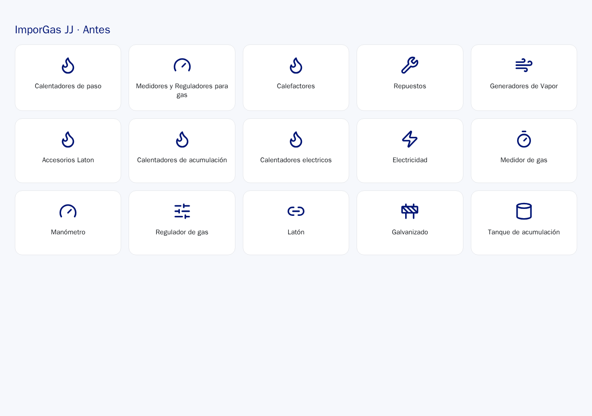
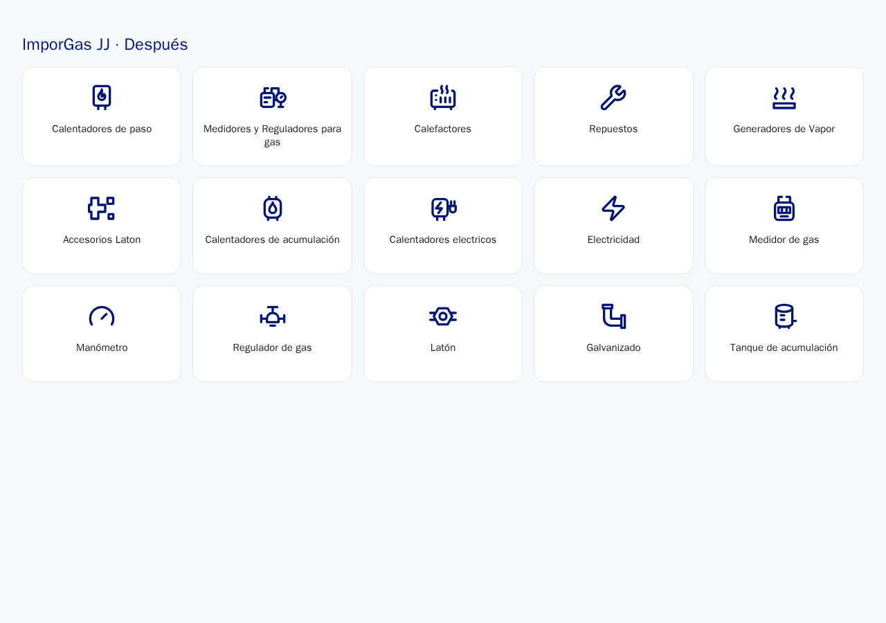

# Iconos de categorías

Rama: `codex/improve-category-icons`. Base: `origin/dev` en `4cc209fcbb4e31cbfb2480bd63ed1a495f670cda` (mismo árbol que main al comenzar). No modifica backend, datos, productos, slugs, orden, inventario ni relaciones. No hay migraciones ni dependencias nuevas.

## Fuente única

`frontend_U/src/components/CategoryIcon.tsx` contiene el registro de componentes y el mapa de los 15 slugs reales, comprobados con una consulta GET a la API pública. El slug conocido tiene prioridad sobre los valores genéricos históricos almacenados en `Category.icon`. Para categorías nuevas se respeta una clave configurada válida; una clave ausente, inválida o heredada de Object cae en `FolderTree`. No se necesita una migración de datos ni una escritura al desplegar.

Inicio, filtros de escritorio/móvil y administración utilizan el mismo componente y slug. La edición muestra vista previa e indica que los iconos de estos slugs son centrales; al guardar otros datos conserva el valor existente de `Category.icon`. Las categorías no incluidas en el mapa mantienen su selector de icono.

| Categoría (nombre existente conservado) | Slug | Componente | Motivo |
|---|---|---|---|
| Calentadores de paso | calentadores | InstantWaterHeater | Caja compacta, llama y conexiones de agua |
| Medidores y Reguladores para gas | reguladores | GasMeterRegulator | Contador acompañado de control de presión |
| Calefactores | calefactores | Heater (Lucide) | Radiador con emisión de calor |
| Repuestos | repuestos | Wrench (Lucide) | Herramienta de reparación |
| Generadores de Vapor | generadores-de-vapor | SteamGenerator | Ondas ascendentes sobre generador |
| Accesorios Laton | accesorios-laton | PipeFittings | Conjunto de conexión y piezas |
| Calentadores de acumulación | calentadores-de-acumulacion | HeatedTank | Depósito redondeado con calentamiento |
| Calentadores electricos | calentadores-electricos | ElectricWaterHeater | Equipo con rayo y enchufe |
| Electricidad | electricidad | Zap (Lucide) | Energía general |
| Medidor de gas | medidor-de-gas | GasMeter | Contador de consumo con dígitos y entradas |
| Manómetro | manometro | Gauge (Lucide) | Indicador de presión con aguja |
| Regulador de gas | regulador-de-gas | PressureRegulator | Diafragma y ajuste entre conexiones |
| Latón | laton | ThreadedCoupling | Tuerca/acople con paso interior |
| Galvanizado | galvanizado | PipeElbow | Codo industrial con extremos de conexión |
| Tanque de acumulación | tanque-de-acumulacion | StorageTank | Depósito vertical sin símbolo de calor |

Lucide instalado: **0.564.0**. Se reutilizan cuatro símbolos y se dibujan once composiciones originales con `createLucideIcon` para distinguir equipos, contadores y conexiones específicos que no cuentan con equivalentes suficientemente precisos. No son imágenes copiadas. Referencias de siluetas: [calentadores Rinnai](https://www.rinnai.us/residential/tankless-water-heaters) y [reguladores Fisher/Emerson](https://www.emerson.com/en/final-control/products/fisher-b-ng). No se descargan ni sirven imágenes de estos sitios.

Todos los SVG: viewBox 24×24, trazo 2, extremos/uniones redondeados, fill none y currentColor. Las importaciones Lucide son explícitas. Se conservan tamaños, tarjetas, colores, hover, foco, espaciado y textos. Los SVG decorativos usan aria-hidden y focusable=false; el texto visible sigue identificando la categoría.

## Comparación de los 15 iconos

Galería generada con los componentes reales, no una ilustración aproximada:

Los PNG son evidencia de revisión; la aplicación utiliza SVG inline. También se capturaron modo oscuro, inicio y administración a tres tamaños en los artefactos locales de prueba. El e-commerce conserva su tema claro existente; las composiciones de la galería también se comprobaron con colores de tema oscuro.

## Validación Docker

- `npm ci`: aprobado con Node 20; package-lock sin modificaciones.
- `npx tsc --noEmit`, `npm run lint`, `npm run build`: aprobados.
- `npm test`: 9/9 (5 nuevas de iconos y 4 existentes de Wompi).
- `npm audit --audit-level=high`: sin altas/críticas; tres moderadas de desarrollo preexistentes en ESLint/minimatch. No se modificaron controles de auditoría.
- Chromium `tests/category-icons.cjs`: inicio, administración, previsualización, filtros, categoría desconocida, consistencia de geometría, tres tamaños (1440/768/390), sin desbordamiento horizontal y sin errores de JavaScript. APIs interceptadas; ninguna escritura real.
- Regresión existente `tests/store-locations-categories.cjs`: siete categorías, pin Norte, Sur, Cómo llegar, fallback y mapa sin clave a 1440/768/390: aprobada.
- No se ejecutaron migraciones ni pruebas de base de datos: ningún modelo, dato o endpoint cambia. La suite backend completa se ejecuta en CI como control de regresión.

Bundle completo (suma de archivos JS, builds limpios):

| Medida | Antes | Después | Diferencia |
|---|---:|---:|---:|
| Archivos JS | 82 | 82 | 0 |
| Bytes JS | 1.430.678 | 1.433.786 | +3.108 (+0,22 %) |
| Bytes gzip (cada archivo) | 454.138 | 455.489 | +1.351 (+0,30 %) |

El build conserva el aviso preexistente de chunks superiores a 500 kB; no se cambió su umbral.

### Reproducir

Ejecutar Node 20 dentro de Docker, copiar `frontend_U` a un directorio aislado, instalar con `npm ci` y ejecutar los comandos anteriores. Construir con `npm run build -- --outDir /evidence/after --emptyOutDir` y servir con `npx vite preview --host 0.0.0.0 --port 4173 --outDir /evidence/after`.

El arnés Chromium usa la imagen `mcr.microsoft.com/playwright:v1.58.2-noble`, Playwright montado en `/tools`, las pruebas en `/audit/tests` y salida en `/evidence`; compartir la red del contenedor de preview. Ejecutar `node /audit/tests/category-icons.cjs` y `node /audit/tests/store-locations-categories.cjs`. Para la galería, extraer la versión base de CategoryIcon.tsx a `/evidence/CategoryIcon.before.tsx` y ejecutar `node tests/category-icons-gallery.mjs` desde el frontend antes de la prueba de navegador.

## Liberación y rollback

PR exclusivo hacia dev; no merge ni despliegue automático en esta tarea. Antes de promover a main revisar dev→main y, si incluye otros trabajos, preparar una rama desde main con solo los commits de iconos y repetir CI. No se requiere configuración ni migración de base de datos. Desplegar únicamente el frontend mediante el flujo aprobado. Rollback: revertir los commits mediante PR o volver a la imagen anterior del frontend, conservando backend, datos, volúmenes y media.

Para añadir una categoría, agregar su slug al mapa y una clave válida al registro, o configurar un icono existente para un slug nuevo. Añadir pruebas para cualquier nueva composición. Los 15 slugs y los valores históricos de base de datos permanecen intactos.
