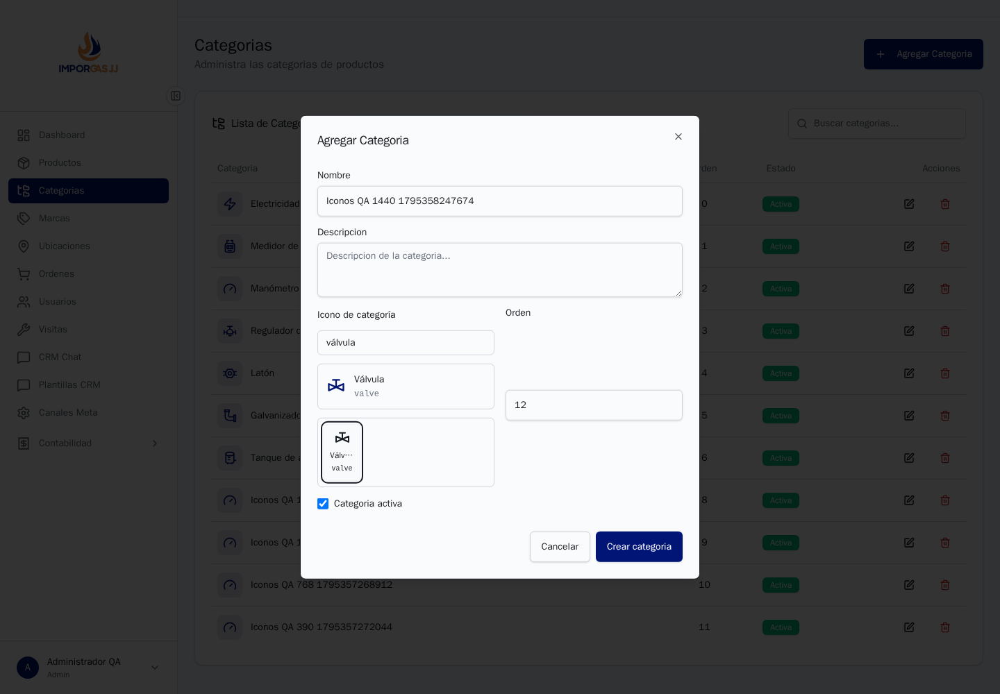
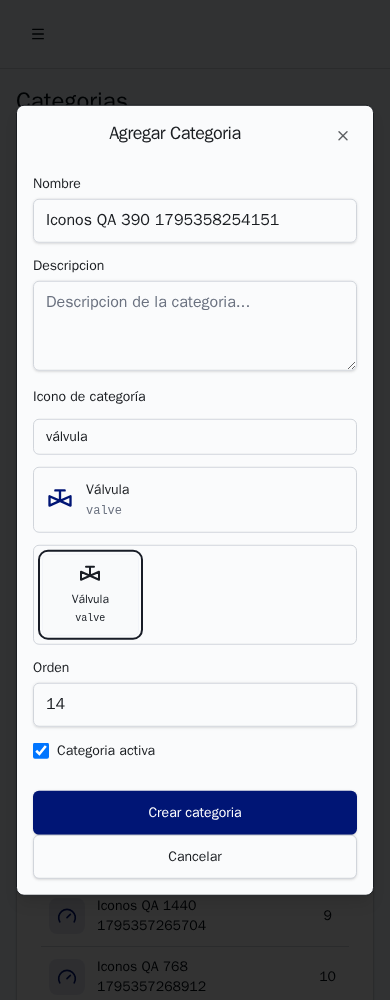
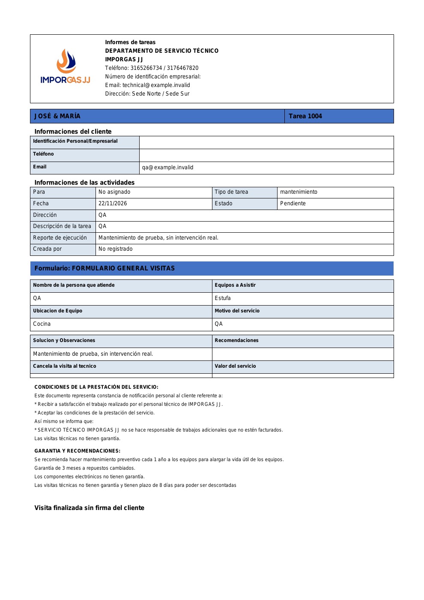

# Auditoría e integración de preparación productiva

Fecha: 2026-11-22. Rama independiente `codex/integration-production-readiness` desde `origin/dev` 4cc209fcbb4e31cbfb2480bd63ed1a495f670cda. `origin/main`: 9d1edf491f9d892209f515b63a56fa9adbb764d7. Mismo árbol al iniciar. Las referencias locales dev/main están atrasadas en fc76b383; no se modificaron. El worktree inicial está detached en 79189d58 y tiene dist generado, un lockfile modificado y documentos/scripts sin seguimiento; quedan fuera. Inventario completo de referencias y worktrees guardado en evidencia local, sin leer secretos.

## Matriz inicial

Los exclusivos se calculan respecto de origin/dev. Los números de atraso cuentan commits, no diferencias funcionales. Una rama sin commits exclusivos puede estar funcionalmente integrada aunque su referencia permanezca antigua.

| Rama/PR | Base común | Objetivo | Estado | Exclusivos | Pruebas conocidas | Dependencias | Acción |
|---|---|---|---|---:|---|---|---|
| origin/dev / #13 | 4cc209fc | Base estable | Ya integrado | 0 | 508 backend, CI previo verde | Ninguna | Base de integración |
| origin/main / #7,11,12 | 9d1edf49 | Versión desplegada | Ya integrado | 0 | CI previo verde | Ninguna | No modificar directamente |
| codex/improve-category-icons / #14 | 4cc209fc | 15 iconos distintos | Listo para integrar | 5 | 508 backend, 9 frontend, Chromium; CI verde | Lucide existente | Merge preservando historia y extender selector visual |
| codex/crm-full-audit | fc76b383 | Red segura, cola y paginación CRM | Necesita validación actual | 3 | Evidencia anterior simulada y worker/Redis reales aislados | Backend y worker juntos, flags | Revisar y probar antes de incluir |
| codex/world-office-product-classification | fc76b383 | Candidatos, inventario, borradores | Excluido de producción / configuración externa | 15 | Contratos y compra simulados; stock/empresa remotos pendientes | Migraciones 0022/0023 chocan con las publicadas; credenciales/empresa/saldos | No integrar; requiere rama propia y migraciones hacia adelante |
| codex/world-office-inventory | fc76b383 | Base World Office | Duplicado parcial / incompleto | 7 | Mocks, alcance anterior | Incluido en rama World Office más nueva | Conservar, no integrar |
| codex/fix-usuarios-trabajadores / #8 | e46de09c | Usuarios y regresión | Duplicado funcional, PR antiguo | 2 | Cambios equivalentes posteriores 1a850e03/540a3592 en dev | Base atrasada 44 commits | No merge completo; comprobar diferencias en suite actual |
| codex/tcc-safe-production-rollout / #9 | e46de09c | Rollout TCC histórico | Necesita revisión / excluido | 3 | Pruebas de base antigua | #8, migraciones antiguas y flags | No merge completo; no publicar migraciones paralelas |
| codex/dev-tcc | d8c6d067 | Compatibilidad de edición histórica | Duplicado parcial / excluido | 1 | Base antigua | Migración 0017 paralela | No integrar completa |
| codex/recover-tcc-on-current-dev | 97f2bc96 | Recuperación histórica TCC | Duplicado parcial / excluido | 11 | Evidencia antigua | Base atrasada 35 commits | Conservar como referencia |
| codex/chatbot-simplificado / #5 | b85efd53 | Simplificación chatbot | Ya integrado | 0 | #5 fusionado | Incluido en dev/main | Sin acción |
| codex/fix-frontend-audit-dependencies / #12 | e45bf1c4 | Auditoría npm | Ya integrado | 0 | CI verde | Ninguna | No duplicar |
| codex/fix-locations-product-categories / #10,11 | 96f2ea7c | Pin y categorías | Ya integrado | 0 | CI y despliegue verificados | Ninguna | No duplicar |
| codex/preserved-local-20260922 | 1ede30cb | Respaldo local antiguo | Excluido de producción | 2 | No validado en base actual | Base atrasada 72 commits | Conservar, no integrar |
| codex/backup-dev-before-tcc-recovery | 97f2bc96 | Respaldo | Ya integrado por ascendencia | 0 | No aplica | Ninguna | Conservar |
| codex/safety-dev-before-general-pr | f5fdf28a | Respaldo | Ya integrado por ascendencia | 0 | No aplica | Ninguna | Conservar |
| codex/safety-dev-before-tcc-split | e46de09c | Respaldo | Ya integrado por ascendencia | 0 | No aplica | Ninguna | Conservar |
| codex/tcc-pre-separation-reference | d8c6d067 | Referencia histórica | Ya integrado por ascendencia | 0 | No aplica | Ninguna | Conservar |

PR #1–7 y #10–13 están fusionados. #8, #9 y #14 estaban abiertos al iniciar. No se eliminan ramas ni se cierran trabajos ajenos sin justificar su equivalencia. Las referencias remotas codex reflejan los mismos heads que sus ramas locales correspondientes; no hay adelantos locales sin publicar en esas ramas. CRM y World Office son trabajos locales sin rama remota propia. No se decide que una rama esté abandonada solo por su fecha.

## Estado funcional inicial

| Módulo | Estado auditado inicialmente | Verificación pendiente |
|---|---|---|
| Catálogo/productos/categorías | Funcional con limitaciones | Selector visual y persistencia de elección |
| Direcciones/carrito/checkout/Wompi | Funcional con limitaciones | Regresión simulada; sin cobros reales |
| TCC | Desactivado/configuración externa | Cotización/guías reales no certificadas, conservar flags |
| World Office | Excluido de esta liberación | Empresa y stock no verificables; conflicto de migraciones |
| CRM/canales/adjuntos/WebSockets | Necesita validación | Integración segura de cola y paginación |
| Plantillas | Funcional con limitaciones | CRUD y adaptación simulada por canal |
| Chatbot/Ollama | Funcional con limitaciones | Contexto, fallos y atención humana; no inventar latencia real |
| Usuarios/trabajadores | Funcional con limitaciones | Suite actual; no integrar rama vieja duplicada |
| Visitas/PDF/correo técnico | Necesita corrección | Nombre visible nuevo y contacto PDF desde configuración |
| Compras/recuperación/email | Funcional con limitaciones | Remitentes e idempotencia; SMTP/Brevo externo separado |
| PostgreSQL/Redis/Celery/Nginx/media | Pendiente de auditoría actual | Contenedores aislados, respaldo, huellas y smoke |

## Estrategia

1. Integrar iconos preservando los cinco commits revisados; ejecutar pruebas frontend.
2. Revisar todo el delta CRM y validar en red Docker interna con transporte externo bloqueado. Sin migraciones de CRM.
3. Añadir selector visual controlado y elección persistida sin alterar los iconos históricos; migración exclusivamente aditiva si corresponde.
4. Corregir solo identidad/contacto de visitas, manteniendo plantillas y PDF, pruebas con locmem.
5. Ejecutar suite completa, build, auditoría, navegador, worker/WebSocket y comparar datos sintéticos antes/después.
6. Solo con controles aprobados: PR de integración hacia dev; luego revisar dev→main y PR de liberación. No desplegar código incompleto ni certificar proveedores externos por mocks.

Los resultados, commits, migraciones, evidencia y rollback se completarán conforme avancen las verificaciones.

## Resultado del candidato integrado

Incorporaciones preservando historia: `6ba49c59` integra los cinco commits de iconos; `4d651d8a` integra `3101f276`, `4f4686cc` y `a549072c` del CRM, tras revisar transporte, colas, paginación, contratos, arneses y documentación. No hubo conflictos. Los cambios nuevos están separados en `f8c031e4` (selector), `9573fb85` (visitas), `9f5fcb82` (dependencias) y `be396f27` (pruebas seguras).

### Correcciones realizadas

- Selector visual con buscador por nombre/clave, galería controlada, vista previa, selección por teclado, estado seleccionado, fallback y errores dentro del formulario. Los quince iconos siguen diferenciados por defecto. Se añaden opciones explícitas de válvula, tubería recta y respaldo, sin dependencia nueva.
- `Category.icon_key` nullable permite una elección del administrador incluso en categorías con slug conocido. El icono anterior y las relaciones permanecen intactos. La elección se muestra en inicio, catálogo y administración después de recargar; los slugs y el orden no cambian.
- Duplicados nuevos se rechazan normalizando nombre, acentos, espacios y slug; duplicados históricos no impiden editar su icono sin cambiar el nombre.
- Remitente técnico central: `ImporGas JJ Servicio Técnico <SERVER_EMAIL_APLICACION>`. La dirección se toma únicamente del entorno. Compras, recuperación, Reply-To y credenciales SMTP permanecen independientes.
- Confirmación de programación de visita: evento `visit_confirmation`, HTML/texto y logo, cola después del commit, idempotencia por tipo/objeto y reintentos existentes. No incluye PDF o enlace inexistente. Cancelaciones/finalizaciones previas al envío cancelan una confirmación obsoleta. El evento de finalización y su PDF conservan su plantilla y protección.
- Contacto del PDF desde la misma variable; prueba compara texto, tamaño y número de páginas y se revisó el render. No se regeneran masivamente PDF históricos ni se modifica media existente.
- Las pruebas antiguas de visitas/categorías suponían catálogos de migraciones iniciales que desaparecían tras `TransactionTestCase` con `--keepdb`. Ahora crean explícitamente sus fixtures. No se añadió seed de producción.
- Arneses de direcciones actualizados a los combobox y campos obligatorios actuales; el test sin transportador distingue catálogo/configuración pública de una cotización real. Los init scripts evitan localStorage en iframes de origen opaco.
- El arnés de navegador redacta JWT/Authorization. Un token sintético apareció en un fallo DNS inicial: se invalidó por versión, se reemplazó y al terminar se desactivó esa cuenta de QA y se retiró su archivo temporal. No era una credencial productiva ni entró en Git.

### Migraciones

| Migración | Operación real | Datos históricos | Rollback |
|---|---|---|---|
| ecommerce.0024_category_icon_key | ADD COLUMN icon_key varchar(64) NULL | Sin UPDATE/DELETE; icon anterior intacto | Mantener columna al volver a imágenes previas |
| transactional_mail.0003_visit_confirmation_kind | Ampliación de choices; SQL no-op | Sin cambio de filas | Conservar eventos y no reprocesar confirmaciones con código antiguo |

Revisados check, makemigrations, showmigrations, migrate --plan y sqlmigrate. No se editan migraciones publicadas. Respaldo lógico aislado de 251640 bytes, catálogo pg_restore válido y restauración completa en otra base exclusivamente de QA; huellas de registros anteriores coinciden. Se compararon posteriormente todos los registros históricos con la copia previa, separando cuentas, chats y categorías sintéticas creadas por los recorridos de QA.

### Pruebas aprobadas

| Grupo | Descubiertas/ejecutadas | Resultado y límite |
|---|---:|---|
| Backend PostgreSQL | 534 | Todas aprobadas, 0 omitidas; locks y concurrencia incluidos |
| Frontend unitario | 10 | Todas aprobadas, 0 omitidas |
| Suites Chromium | 26 | Todas aprobadas; escritorio/tableta/móvil |
| CRM tras incorporación | 192 | Aprobadas con guard de sockets |
| Worker/Redis/ASGI | Smoke real aislado | message.created/updated/session.updated, adjunto protegido, plantilla y duplicados=0 |
| Selector | UI + backend reales | Crear/editar/recargar, teclado, error conserva contenido, catálogo persistido a 1440/768/390 |
| Compra completa | PostgreSQL y UI reales | Login→dirección→carrito→cotización→pago sintético→pedido→evento duplicado→seguimiento |
| Subsidio | 1999999 / 2000000 / 2100000 | Umbral inclusive, tarifa 30000 / cliente 0 / subsidio 30000, un pedido y una guía sintética |
| Recuperación | Backend locmem + navegador | Respuesta neutral, token de un uso, contraseña anterior/nueva y URL protegida |
| PDF/correo técnico | MIME y PDF generados | From exacto, texto/HTML, sin duplicación, misma geometría PDF |
| Seguridad | Gitleaks | Sin secretos en commits; escaneo redactado y sin red |

El primer pase global falló por fixtures ausentes al reutilizar la base (10 fallos de visitas + 1 de categorías); después de corregirlos pasó la suite completa. Los primeros dos tests de iconos fallaron por usar otra ruta de Playwright no incluida en la regla DNS; corregido el arnés y repetidos con éxito. El test antiguo de direcciones usaba selectOption y omitía destinatario/teléfono; se corrigió sin cambiar la aplicación de envíos. Ningún check se desactivó ni se redujo su umbral.

### Dependencias

Se actualizó exclusivamente `@typescript-eslint/parser` 8.72.0→8.73.0 y su cohorte/transitivas oficiales: minimatch 10.2.6→11.0.9, brace-expansion 5.0.12→5.0.13, semver 7.8.5→7.8.6 y dependencia auxiliar del parser. Node 20 satisface sus engines; TypeScript continúa 5.7.3. No se hizo una actualización masiva ni audit fix --force. `npm ci`, lint, TypeScript, build y pruebas pasan. **npm audit completo: 0 vulnerabilidades**, frente a 3 moderadas de desarrollo antes. El aviso previo de chunks mayores a 500 kB sigue siendo informativo y no se ocultó.

### Estado por módulo

| Módulo | Estado final de desarrollo | Evidencia / límite externo |
|---|---|---|
| E-commerce/productos/categorías | Corregido | Catálogo/filtros/imagen/CRUD; relaciones preservadas |
| Iconos/selector | Corregido | Persistencia real y responsive; galería no importa componentes arbitrarios |
| Direcciones/carrito | Correcto | Tres tipos de usuario, guardado y privacidad al cambiar sesión |
| Checkout/Wompi | Funcional con limitaciones | Persistencia e idempotencia reales; proveedor/pagos simulados |
| TCC/envío gratis | Funcional con limitaciones / flag productivo conservado | Transporte y guía simulados; ningún despacho real |
| World Office | Excluido de producción | Rama aparte, conflictos de migración y stock/empresa externos pendientes |
| CRM/búsqueda/filtros/paginación | Corregido | 201 conversaciones y 200 mensajes paginados sin duplicación; todos los canales |
| CRM multimedia | Correcto localmente | Imágenes/audio/video/PDF, permisos y errores; sin envío a proveedores reales |
| Plantillas | Correcto localmente | Página normal, editor por acción, CRUD, variables, compatibilidad, preview, envío simulado |
| WebSockets | Correcto localmente | Nginx→ASGI→Redis, JWT, ping/pong y reconexión |
| WhatsApp/Baileys | Funcional con limitaciones | Adaptadores/health y contratos; no login/QR ni mensajes reales |
| Facebook/Instagram | Bloqueado para validación externa | Contratos y restricciones simulados; permisos/entrega reales no certificados |
| Chat e-commerce | Correcto localmente | Mensajes/adjuntos y contexto propio separados |
| Chatbot/Ollama | Funcional con limitaciones | Ocho conversaciones concurrentes, caída/timeout/intervención humana; tiempos de mocks, no inferencia real |
| Usuarios/trabajadores | Correcto | Regresión completa, permisos, inactivos y revocación; no merge de #8 duplicado |
| Visitas/PDF | Corregido | Contacto técnico de entorno y PDF persistido/protegido; históricos no reescritos |
| Correo compra/recuperación/visitas | Corregido localmente | MIME/remitentes/reintentos; SMTP real se verifica aparte, sin clientes reales |
| Celery/Beat | Correcto localmente | Ping, scheduler, broker y recuperación; sin otro scheduler |
| PostgreSQL/Redis | Correcto | Salud, restore aislado y huellas |
| Media | Correcto en QA | No se borraron medios ajenos; adjuntos sintéticos protegidos |
| Nginx/HTTPS | Pendiente del smoke productivo | Nginx aislado validado; producción requiere comprobación posterior |

### Autenticación de correo observada (solo lectura, 2026-11-22)

SPF del dominio: `v=spf1 include:zohomail.com ~all`. DKIM Brevo: CNAME brevo1 y brevo2 publicados. DMARC: `p=none` con reportes a Brevo. BIMI: sin registro. Esto no demuestra SPF/DKIM/DMARC pass de un mensaje concreto ni su alineación: requiere encabezados recibidos. No se modificó DNS ni se redujo DMARC. No hay VMC/CMC autorizado. El logo HTML es independiente del avatar y se conserva inline.

### Contenedores y separación

QA usa su propio proyecto `integration-readiness`, PostgreSQL, Redis, backend, worker, Beat, Nginx, frontend y fixtures e2e, con **red interna** y simulación de CRM. La cuenta y JWT temporales solo existen en QA. El Beat inicial no heredó SECRET_KEY en un override local; se corrigió la herencia y se comprobó su arranque. No se reiniciaron contenedores de otros proyectos ni se eliminaron volúmenes. Los transportes externos están bloqueados tanto por configuración como por red y, en la suite backend, por socket guard.

Auditoría productiva de lectura inicial: main limpio en 9d1edf49, 71 GB disponibles, PostgreSQL/Redis saludables, 852 archivos de media, sin migraciones pendientes. No se aplicó ningún cambio durante esa auditoría.

## Reproducción de QA

Configuración versionada: `docker-compose.crm-audit.yml` + `docker-compose.readiness.yml`; fixtures de compra/recuperación en `docker-compose.readiness-e2e.yml`. Generar READINESS_INTERNAL_TOKEN sintético en el entorno o archivo privado ignorado, sin mostrarlo; no usar .env de producción. Construir backend y levantar database/redis/backend. Ejecutar migraciones y tests con `--testrunner crmChat.audit_runner.AuditRunner --noinput`. Levantar worker/Beat con perfil smoke y broker Redis; ejecutar `python manage.py shell -c 'import crmChat.audit_smoke'`.

Frontend: contenedor Node 20, copia aislada de frontend_U, npm ci, npm audit, lint, TypeScript, npm test y build. Servir preview 4173 y conectarlo a la red interna con alias frontend. Nginx QA expone 80 y 4173 solo dentro de Docker. Instalar Playwright 1.58.2 en un volumen de herramientas aislado; usar imagen mcr.microsoft.com/playwright:v1.58.2-noble, montarlo en /tmp/crm-ui y /tools, tests en /audit/tests, qa/readiness en /qa y evidencia en /evidence.

`qa/readiness/run-browser.sh` ejecuta el lote; el preload resuelve únicamente nombres de QA y redacta errores. Los cinco tests con fixture mutable deben ejecutarse secuencialmente reiniciando **solo su fixture** entre casos; el test de selector real usa una cuenta creada mediante `qa/readiness/prepare-browser.py`, guarda su JWT en un archivo temporal ignorado y debe revocarlo al terminar. El script auxiliar location-select.cjs no es una suite omitida.

## Liberación y rollback

Revisar todos los checks del PR de integración antes de fusionar a dev. Comparar dev→main: solo incluir esta versión aprobada; World Office y ramas antiguas permanecen excluidos. Si aparece trabajo ajeno en dev, usar rama de liberación desde main con los commits aprobados. Registrar URLs, merge SHA y evidencia real en la descripción del PR y en el informe final de ejecución; no escribir correcciones directamente en producción.

Despliegue: comprobar main/árbol limpio, registrar commit e imágenes previas, respaldo pg_dump verificado y copia restringida de .env.prod, inventariar montajes y huellas de media. Pull --ff-only del commit aprobado, construir backend/frontend/worker/chatbot/beat, revisar migrate --plan y aplicar únicamente las dos migraciones previstas. Configurar explícitamente CRM_TEST_MODE=false, CRM_EXTERNAL_SEND_ENABLED=true y CRM_ASYNC_OUTBOUND_ENABLED=true; conservar destinatarios, SMTP, TCC y World Office. Recrear solo servicios de aplicación y recargar Nginx después de comprobar su sintaxis. No tocar contenedores/volúmenes de datos.

Rollback: conservar imágenes anteriores, respaldo y esquema aditivo. Un rollback frontend puede recuperar la imagen anterior directamente. Para backend, detener primero los consumidores, revisar mensajes asíncronos queued/processing y entregas inciertas para evitar reenvíos; no consumir nuevas tareas con un worker antiguo sin conciliarlas. Antes de volver al servicio de correo antiguo, cancelar los eventos visit_confirmation pendientes/fallidos (conservar filas y motivo de rollback) y revisar los sending como inciertos: ese tipo no existe en la versión previa. Volver a imágenes previas solo después de esa comprobación. No revertir columnas ni restaurar PostgreSQL sin autorización adicional; no borrar media. La corrección permanente debe hacerse en esta rama mediante Git/PR y volver a sincronizar dev/main.

## Evidencia visual

## Bloqueo posterior de seguridad — no fusionar todavía

El escaneo completo del árbol (además del delta de la integración) detectó seis JWT literales heredados en scripts manuales y cuatro coincidencias adicionales. Cinco JWT tienen exp vencido y uno declara exp futuro (2027-01-05); esto no prueba que su firma o cuenta sean válidas actualmente. No se muestran valores ni claims de identidad. Los cuatro hallazgos adicionales eran dos tokens ficticios de documentación y dos fixtures deterministas de pruebas, no credenciales activas.

Saneamiento preparado únicamente en commits locales: retirar los seis literales; hacer que las utilidades tomen tokens solo del entorno; no imprimir claims privados; bloquear sondas fuera de QA/local y no seguir redirecciones; desactivar los experimentos heredados que creaban una cuenta con contraseña fija o cargaban CSV fuera de la suite aislada. Los ejemplos de documentación pasan a placeholders y los dos falsos positivos de fixtures tienen una excepción inline específica y justificada, no una desactivación general del escáner. Cinco pruebas nuevas cubren estas garantías.

No se reescribe el historial: los JWT antiguos deben tratarse como expuestos. El PR #15 permanece en borrador. El usuario autorizó posteriormente publicar el commit de saneamiento fb28c1d6 después de escanearlo; esa publicación no revoca credenciales ni elimina el historial compartido.

El usuario prohibió expresamente comprobar los JWT históricos contra producción. No se ejecutó esa comprobación ni se accedió a datos usando los tokens; los helpers privados anteriores quedaron deshabilitados. La revocación preventiva está condicionada a cobertura completa y titularidad confirmada. La revisión encontró que Socket.IO del gateway no comprueba la versión de la cuenta y que tokens DRF y sesiones Django requieren revocación explícita. Por ello no se modificó producción.

Situación: CI del head publicado f30e2170 aprobado (534 backend, frontend y WhatsApp); saneamiento posterior local pendiente de publicación/CI tras resolver el bloqueo. Producción sigue en main 9d1edf49 sin pull, migraciones ni recreación. Respaldo previo verificado: /root/imporgas-release-backups/20261122T144451Z-integration-readiness, dump de 751536 bytes y media inventariada de 852 archivos.

Actualización 2026-11-23: 540 pruebas backend, 15 específicas de seguridad/autenticación/WebSockets, 10 frontend y 38 gateway aprobadas. Árbol y delta de integración: cero hallazgos Gitleaks. Historial alcanzable: 31 hallazgos, incluyendo seis JWT y posibles secretos adicionales heredados en archivos de entorno. Inventario exacto y plan coordinado en [SECURITY_TOKEN_REMEDIATION.md](SECURITY_TOKEN_REMEDIATION.md). No fusionar ni desplegar mientras esos bloqueos continúen, aunque CI quede verde.
